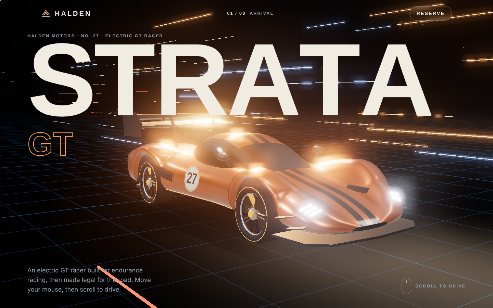
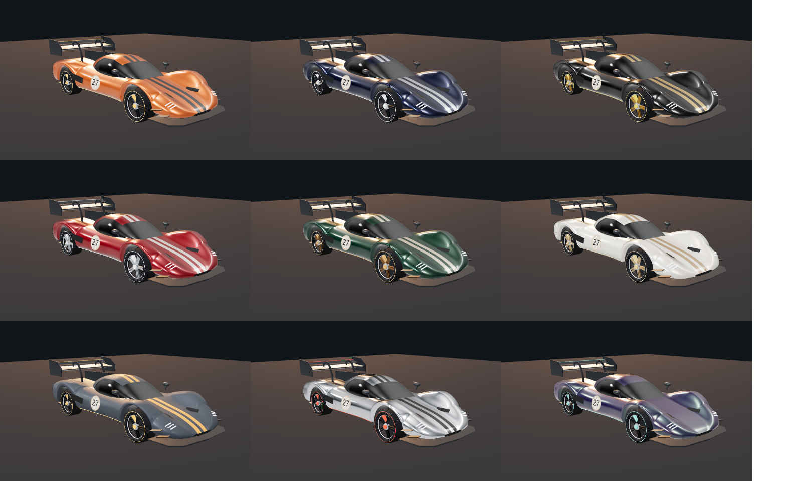

# Halden Strata GT — Immersive 3D Car Experience

A scroll-driven 3D website for a concept electric GT race car. The camera flies around the car as you scroll, the world reacts to your mouse, and the page mixes WebGL, GPU shaders and parallax.

**Stack:** Next.js 15 (App Router) · TypeScript · Tailwind CSS v4 · Three.js · Lenis · Vercel



### 9 luxury paint editions



## Features

| Effect | What it does | File |
|---|---|---|
| Scroll-driven 3D camera | Each section has a camera "shot". Scrolling blends between shots around a procedural car | `lib/fx/car-scene.ts` |
| Procedural GT race car | Lofted body built from 220 cross-sections (fender peaks, wheel arches, teardrop canopy), swan-neck wing, splitter, diffuser, livery. No 3D model files | `lib/fx/car-model.ts` |
| Virtual-space world | Shader grid floor, 260 instanced light streaks, starfield, bloom glow | `lib/fx/car-scene.ts` |
| Water ripples | GPU height-field simulation (ping-pong render targets) with refraction | `lib/fx/ripple.ts` |
| Parallax layers | Seeded SVG mountains, city and highway move at different depths | `components/NightRun.tsx`, `lib/fx/motion.ts` |
| Cursor-reactive | Custom cursor, magnetic buttons, 3D tilt cards with glare, mouse parallax camera | `lib/fx/motion.ts` |
| Scroll-velocity ticker | The marquee speeds up, skews and flips direction with your scroll | `lib/fx/motion.ts` |
| Smooth scroll | Lenis inertia scrolling | `lib/fx/motion.ts` |
| Luxury paint editions | 9 full palettes (paint, finish, stripe, accent metal, wheels): gloss, pearl, satin, liquid chrome and colour-shift. Stripes are coloured by a custom shader edit; changes blend over 0.9 s | `lib/editions.ts`, `lib/fx/car-model.ts` |
| Multi-currency pricing | EUR, USD, GBP, AED and PKR with local number formats, plus a build code you can copy | `lib/fx/configurator.ts` |
| Lighting moods | Night, Studio and Golden hour change the lights, reflections, bloom and floor | `lib/fx/car-scene.ts` |
| 3D hotspots | HTML buttons pinned to parts of the car; they follow it as it turns and hide when facing away | `lib/fx/car-scene.ts`, `lib/fx/configurator.ts` |
| Synthesised EV sound | Web Audio motor whine, inverter hum and wind that follow the car's speed (no audio files) | `lib/fx/sound.ts` |
| Metric / imperial | Spec cards switch between km/h, kW, km and mph, hp, mi | `lib/fx/configurator.ts` |
| World studios | Live local time and open/closed status for six cities | `lib/fx/configurator.ts` |

It respects `prefers-reduced-motion`. The 3D world stops rendering when it is hidden. On touch screens it skips the custom cursor and tilt effects.

## How it is built

The sections in `app/page.tsx` are **server components**: plain HTML with `data-fx`, `data-cam`, `data-depth` and similar attributes. One small **client component**, `components/Effects.tsx`, calls `mountAll(document)` in `useEffect`. That function finds those attributes and starts each effect. Each effect returns a cleanup function, so React can stop everything when the component unmounts.

```
app/
  layout.tsx      fonts, cursor elements, <Effects />
  page.tsx        all sections (server-rendered)
  globals.css     Tailwind theme tokens + effect CSS
components/
  Effects.tsx     the one "use client" component
  NightRun.tsx    parallax skyline section
lib/fx/
  index.ts        mountAll(): starts every effect
  car-model.ts    procedural 3D car
  car-scene.ts    3D world, camera shots, bloom, moods, hotspots
  ripple.ts       GPU water simulation
  motion.ts       smooth scroll, parallax, cursor, tilt, magnetic, marquee, progress
  configurator.ts editions, currency, moods, hotspot cards, units, studio clocks
  sound.ts        synthesised EV sound
  bus.ts          live values shared between effects
lib/
  editions.ts     paint editions, currencies, hotspots, studios (shared data)
```

## Run it

```bash
npm install
npm run dev        # http://localhost:3000
npm run build      # production build + type check
```

## Deploy

1. Push to GitHub.
2. Import the repo on [vercel.com](https://vercel.com). Vercel detects Next.js, so you do not need any settings.

---

Halden Motors is a fictional brand. Designed and built by Arooj Dogar.
